

# DECK RATS

### A first-person pirate adventure · In development

**Build a crew. Read the wind. Find your way across a living Caribbean archipelago.**

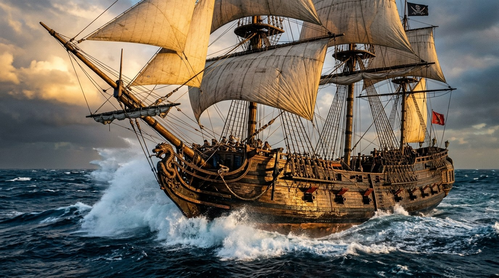

*Concept artwork for visual direction; not an in-game screenshot.*

> **Project preview:** Deck Rats is an in-development Unreal Engine 5.8 game. This repository is a media and campaign preview, not the game's source repository.

## In-engine captures

These are from development and review builds; some retain interface or debug overlays.

| Sunset at sea | Night sky | Island approach |
|---|---|---|
|  |  | 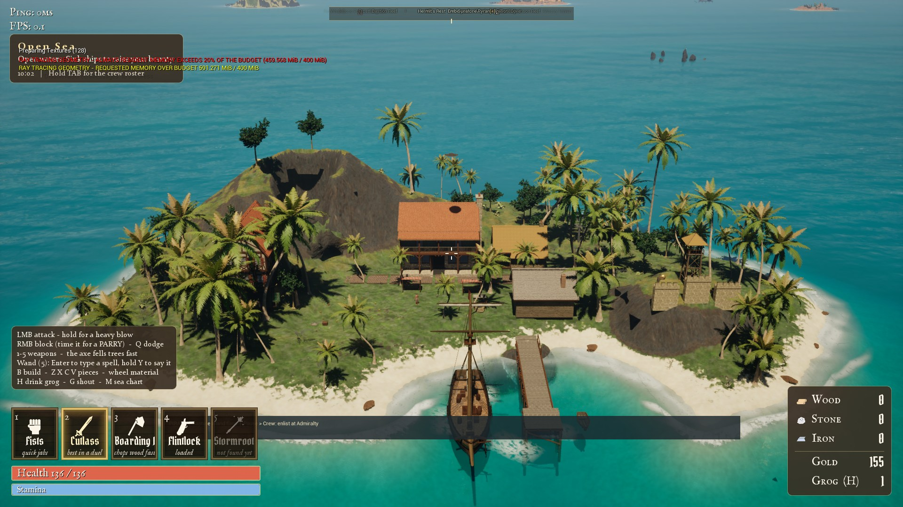 |
| Fair weather | Storm review | Rough sea |
| 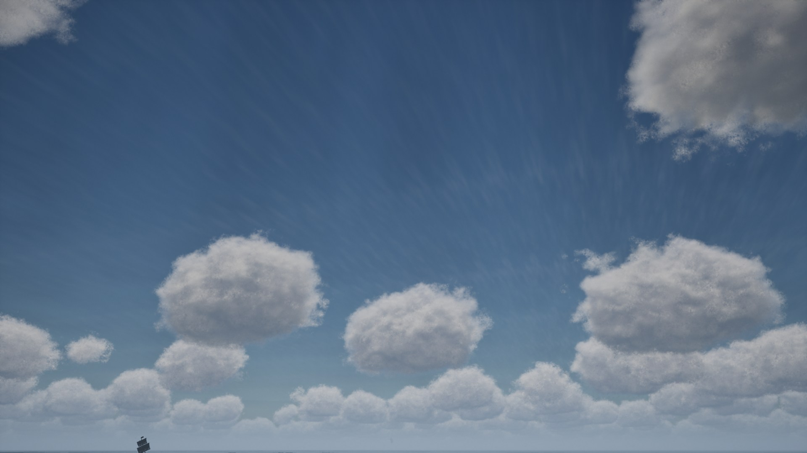 |  | 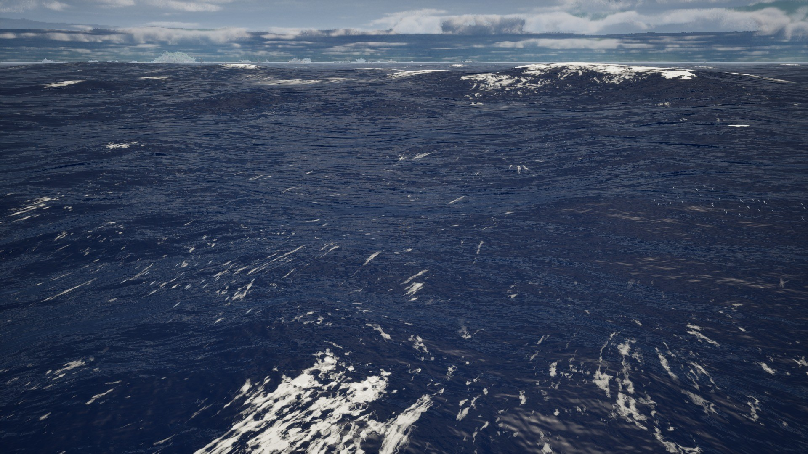 |

## Islands and systems

| Port Haven | Verdant | Frostfang |
|---|---|---|
|  | 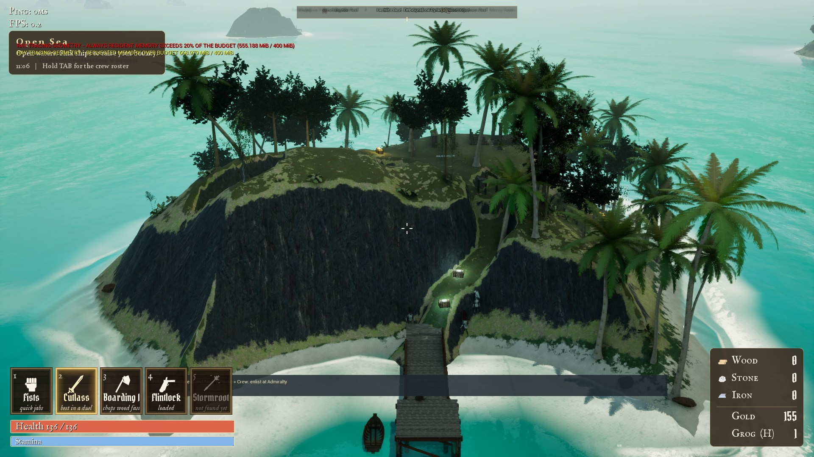 | 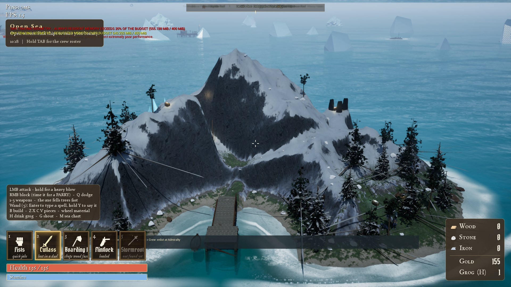 |

The project is building sailing and ship combat, changing weather, island exploration, crew and story systems, and a PvPvE direction. The game remains in active development; this page does not imply a release date or finished feature set.

## Interface and crew

| Stories at the tavern | Captains |
|---|---|
| 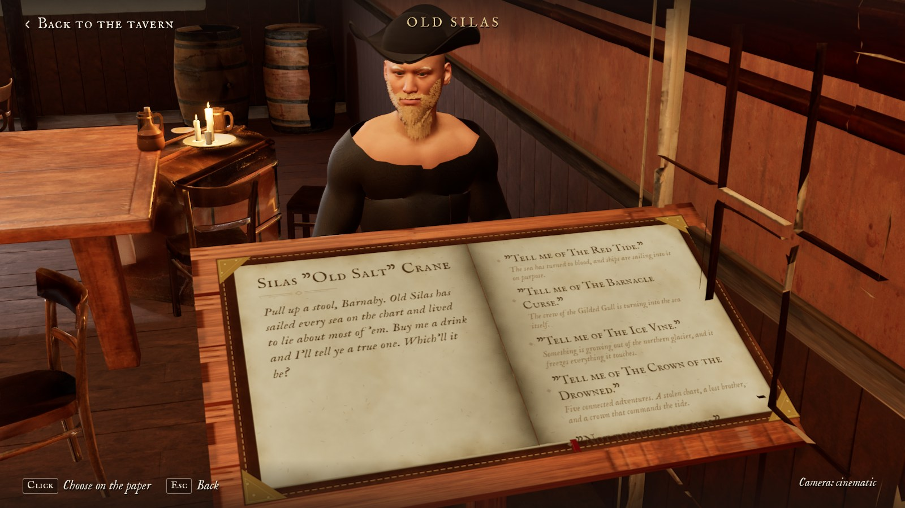 | 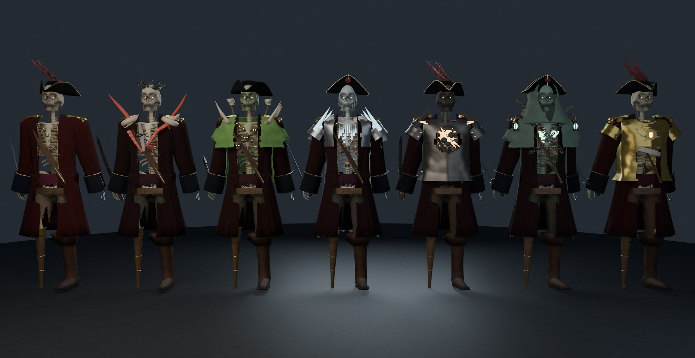 |

## Visual concepts

The following are concept and reference images, not gameplay captures.

| Archipelago concept | Tavern concept | Ship concept |
|---|---|---|
| 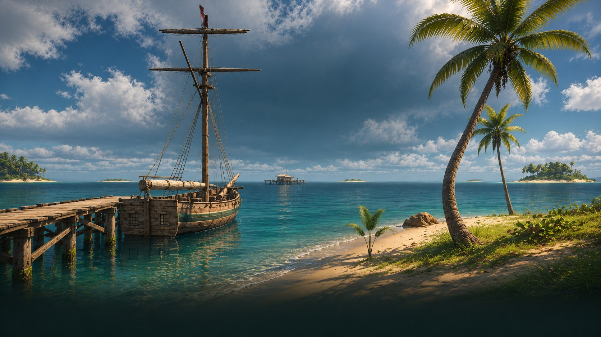 | 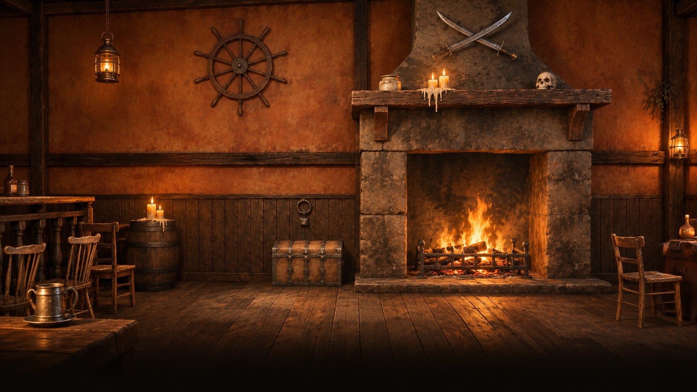 | 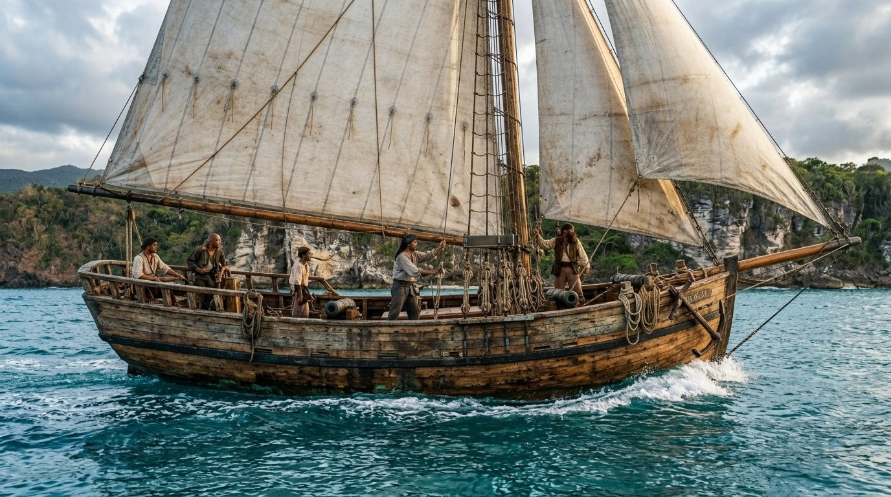 |

## Campaign contact

**3rcian.yt@gmail.com**

For the full responsive visual page, open [`index.html`](index.html). See [`campaign-copy.md`](campaign-copy.md) and [`campaign.json`](campaign.json) for the campaign text and image notes.
