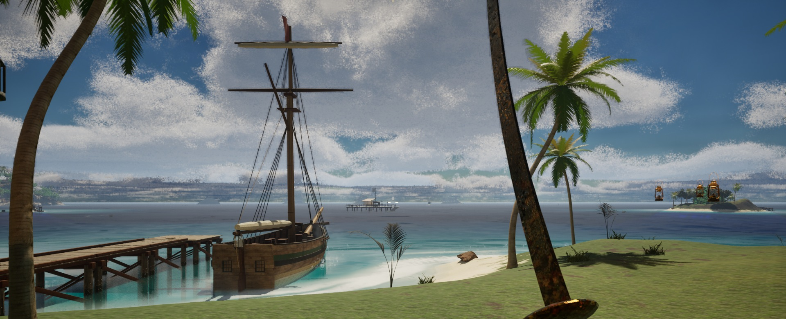
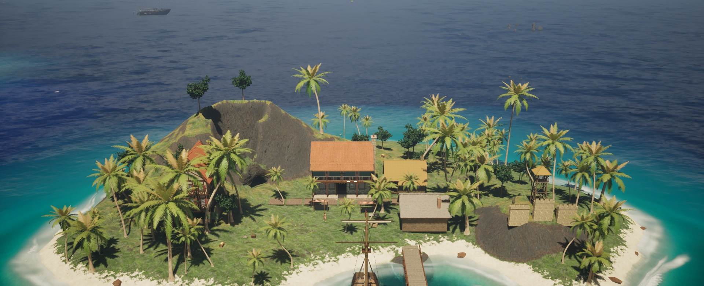
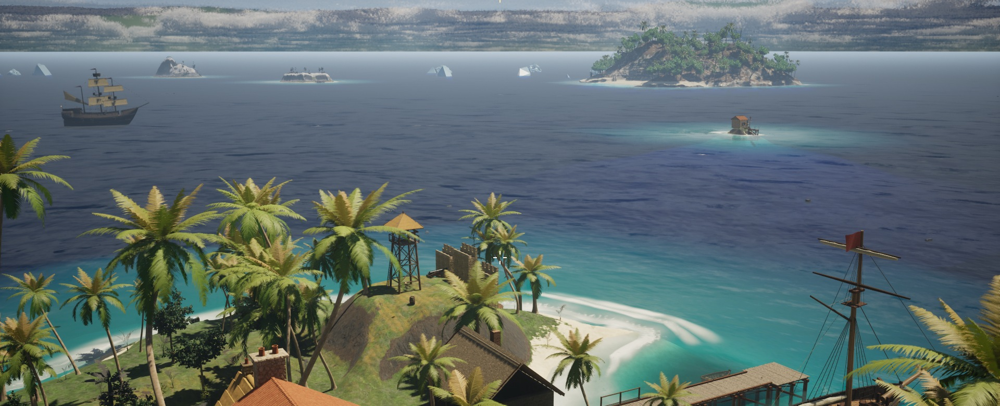
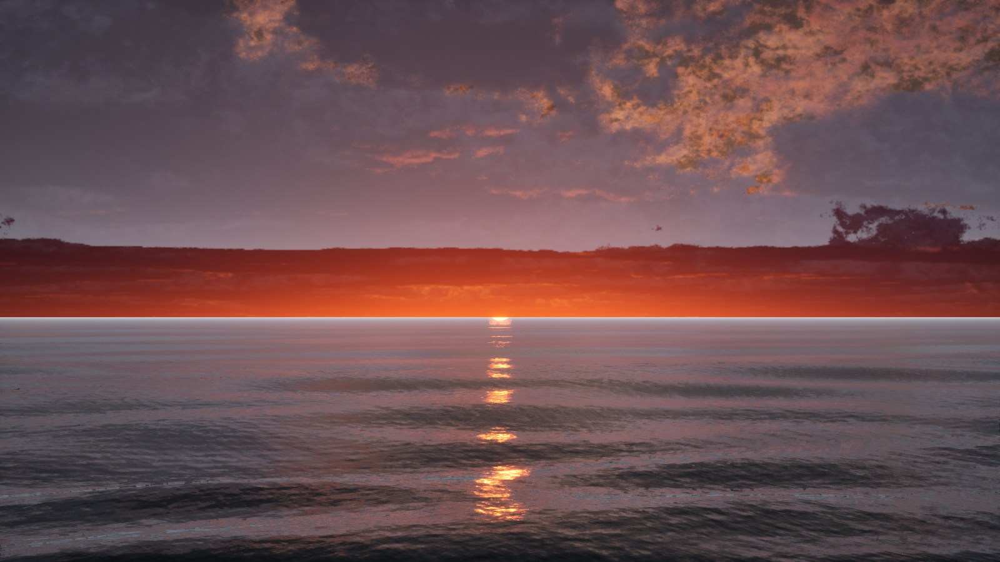
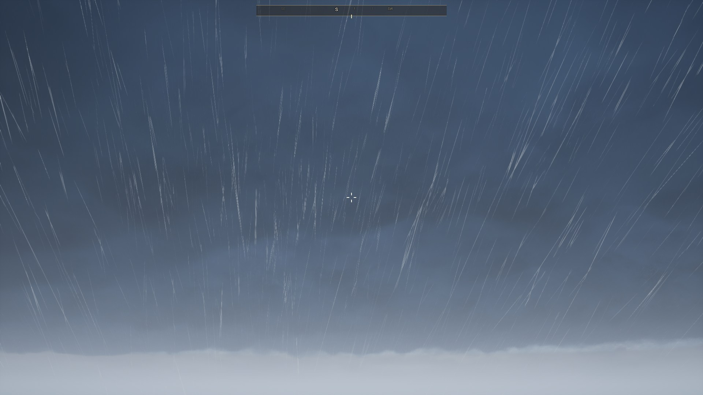

# DECK RATS

### A first-person pirate adventure · In development

**Build a crew. Read the wind. Find your way across a living Caribbean archipelago.**

*In-game development capture from 7 November 2026; cropped to remove temporary debug banners.*

> **Project preview:** Deck Rats is an in-development Unreal Engine 5.8 game. This repository is a curated media and campaign preview, not the game's source repository.

## Recent in-game captures

These three views are from the 7 November 2026 development build. They are genuine in-game images; only temporary debug banners have been cropped out.

| At the island pier | Port Haven from above | Coastline and open water |
|---|---|---|
|  |  |  |

## Sky and sea material studies

Environment captures made in-engine on 12 November 2026. These are focused material and lighting studies rather than finished gameplay scenes.

| Sunset | Night sky | Fair-weather clouds |
|---|---|---|
|  |  |  |
| Rain and storm light | Wind over open water | |
|  |  | |

## Visual concepts

The following images show visual direction only. They are not gameplay screenshots.

| Galleon at dusk | Archipelago | Tavern |
|---|---|---|
|  |  |  |

The project is building sailing and ship combat, changing weather, island exploration, crew and story systems, and a PvPvE direction. The game remains in active development; this page does not imply a release date or finished feature set.

## Campaign contact

**3rcian.yt@gmail.com**

For the full responsive visual page, open [`index.html`](index.html). See [`campaign-copy.md`](campaign-copy.md) and [`campaign.json`](campaign.json) for campaign text and media notes.

